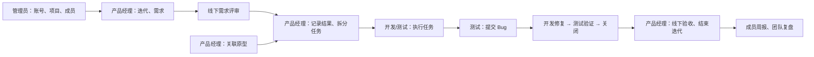

# 业务闭环开发计划

> 目标：使平台在“线下需求评审”的工作方式下，可靠闭环项目、需求、任务、Bug、迭代和周报。
>
> 不在本计划内：线上需求评审、评审意见/评论系统、发布管理、工时审批。

## 一、目标流程

## 二、实施原则

1. **服务端权限为准**：前端按钮只优化体验，所有写接口必须在服务端鉴权。
2. **接口契约唯一**：统一使用 camelCase 查询参数，写入字段保持现有 snake_case；对已有不一致处一次性修正并补测试。
3. **评审在线下完成**：需求状态只记录线下结论和执行进度，不开发线上评审流程、评审人或评审记录。
4. **关联必须可追溯**：需求、任务、Bug、原型和附件的关联均须保存、读取并在详情页正确展示。

## 三、阶段计划

### 阶段 0：建立回归基线（P0，0.5 天）

**目的**：让后续修复有可重复的验证手段。

- 为权限工具、任务查询参数、需求附件、需求状态保留增加单元/接口测试。
- 以五个种子角色（admin、pm、project_manager、developer、tester）建立权限测试矩阵。
- 在测试环境准备一个项目、需求、任务、Bug、原型和迭代的关联数据。

**验收标准**

- `npm test` 覆盖以下失败场景：未登录写入、无权写入、任务按需求过滤失败、附件未保存、编辑需求状态被重置。
- `npm run build` 通过。

### 阶段 1：修复需求—任务—附件关联（P0，1 天）

#### 1.1 修复需求详情的关联任务查询

- 页面传递 `requirementId`，值使用 `requirement.req_id`（数据库主键），与任务列表 API 一致。
- 保持任务 API 的查询参数为 `projectId`、`requirementId`、`assigneeId`、`status`。
- 补充需求详情页的空态、加载态与刷新逻辑。

涉及文件：

- `pages/requirements/[id].vue`
- `server/api/tasks/index.get.ts`

**验收标准**：进入任一需求详情，只显示其关联任务；新增任务后列表立即出现；其他需求任务不出现。

#### 1.2 持久化需求附件

- 在需求创建和更新 API 接收 `attachments`。
- 将上传成功后的附件元数据写入 `requirements.attachments` JSON 字段。
- 编辑需求时回填附件；删除附件时仅移除业务关联（物理文件回收作为后续运维任务）。
- 统一附件对象结构：`url`、`filename`、`size`、`type`。

涉及文件：

- `components/RequirementModal.vue`
- `server/api/requirements/index.post.ts`
- `server/api/requirements/[id].get.ts`
- `server/api/requirements/[id].put.ts`

**验收标准**：上传并保存需求后刷新页面，附件仍存在且可打开；编辑后新增/移除附件的结果正确保存。

### 阶段 2：统一权限与账号/成员管理（P0，1.5 天）

#### 2.1 固化任务创建规则

产品决定后采用一个唯一规则。建议：**仅 admin、pm 创建和拆分任务；所有角色可更新自己负责或创建的任务。**

- 将前端权限矩阵、后端权限矩阵和任务创建接口统一。
- 需求详情“新建任务”按钮沿用同一规则。

涉及文件：

- `composables/useAuth.ts`
- `server/utils/permissions.ts`
- `server/api/tasks/index.post.ts`
- `pages/tasks.vue`
- `pages/requirements/[id].vue`

**验收标准**：developer/tester 看不到且无法调用建任务接口；admin/pm/project_manager 可创建；负责人可更新自己任务。

#### 2.2 保护项目成员管理

- 为添加成员、更新项目成员角色、移除成员接口接入 `authorize(event, 'project', 'update')`。
- 校验角色值、项目存在性和成员归属。
- 明确项目 owner 策略：建议项目至少保留一名 owner；禁止移除最后一名 owner。

涉及文件：

- `server/api/projects/[id]/members.post.ts`
- `server/api/projects/[id]/members/[userId].put.ts`
- `server/api/projects/[id]/members/[userId].delete.ts`

**验收标准**：admin/pm 可管理成员；其他角色和未登录请求均返回 401/403；不会移除最后一名 owner。

#### 2.3 保护账号管理和上传

- `POST /api/users` 仅允许 admin。
- `POST /api/upload` 至少要求已登录；如需更严控制，按目标资源创建权限校验。
- 所有业务读取接口接入登录和 read 权限校验，避免绕过页面读取数据。

涉及文件：

- `server/api/users/index.post.ts`
- `server/api/upload.post.ts`
- `server/api/**/**/*.get.ts`（按资源统一接入）

**验收标准**：匿名用户不能读取业务数据、不能上传、不能创建账号；各角色只可读取权限矩阵允许的资源。

### 阶段 3：使需求状态符合线下评审模式（P1，0.5 天）

- 删除需求详情页无实际实现的“状态流转”按钮。
- 删除硬编码的评审人和评审记录展示。
- 编辑需求时默认保留原状态，禁止每次保存都写回 `pending`。
- 由 PM 在编辑需求时选择状态，作为线下评审结果和执行进度的**记录**；不新增线上审批动作。

涉及文件：

- `pages/requirements/[id].vue`
- `components/RequirementModal.vue`
- `server/api/requirements/[id].put.ts`

**验收标准**：编辑已完成需求不会变回“评审中”；页面不展示虚构评审信息；PM 可准确记录线下评审后的状态。

### 阶段 4：流程回归与上线准备（P1，1 天）

按角色完成端到端验收：

1. **管理员**：创建账号、项目、成员；验证无权用户无法绕过接口。
2. **产品经理**：创建迭代、需求，记录线下评审结果，拆分并指派任务，结束迭代。
3. **产品经理**：创建原型并关联需求。
4. **开发**：更新本人任务，修复本人 Bug。
5. **测试**：创建 Bug，验证并更新 Bug 状态。
6. **全员**：填写周报；PM 查看团队周报。

**最终验收标准**

- 每个动作都由正确角色完成，错误角色收到明确的 401/403。
- 需求详情的任务、原型、Bug、附件均与数据库一致。
- 需求评审不要求线上操作，状态仅反映线下结论/执行状态。
- 从项目创建到迭代结束、周报复盘可以完整跑通一次。
- `npm test` 与 `npm run build` 均通过。

## 四、排期与依赖

| 阶段 | 优先级 | 估时 | 依赖 | 交付物 |
|---|---:|---:|---|---|
| 阶段 0：测试基线 | P0 | 0.5 天 | 无 | 回归用例与种子数据 |
| 阶段 1：关联修复 | P0 | 1 天 | 阶段 0 | 正确的任务关联与需求附件 |
| 阶段 2：权限统一 | P0 | 1.5 天 | 阶段 0 | 可信的角色边界 |
| 阶段 3：线下评审适配 | P1 | 0.5 天 | 阶段 1 | 正确的需求状态表达 |
| 阶段 4：端到端验收 | P1 | 1 天 | 阶段 1、2、3 | 上线验收记录 |

**总估时：4.5 个开发人日。** 阶段 1 与阶段 2 可在阶段 0 完成后并行实施，实际日历工期约 3 天。

## 五、暂不开发项

- 线上需求评审、评审意见流、评论系统。
- 发布版本、部署审批、自动化 CI/CD。
- 附件的物理删除与对象存储生命周期回收。
- 任务/迭代结束时强制校验所有事项完成（当前采用人工管控）。
